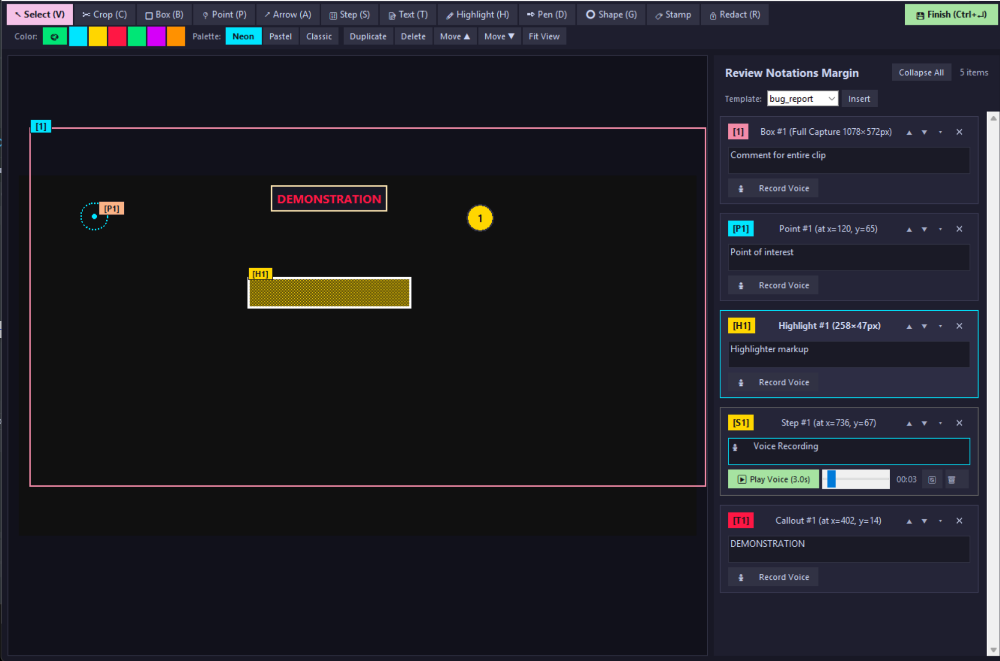

# PromptLens

A focused screen capture and visual review suite built for pairing with AI coding agents and multimodal models.

Captures screenshots and long scrollable windows, lets you mark up areas of interest with numbered badges and inline voice memos, and exports clean markdown manifests with absolute paths copied straight to your clipboard so you can paste them into your agent sessions.



---

## Download Standalone & Portable Builds

Pre-built Windows executables (zero Python or AutoHotkey installation required) are available on the [**Releases**](https://github.com/SoulFlux-Dev/PromptLens/releases/latest) page:

| Package | Description | Direct Download |
|---|---|---|
| **Portable Edition (Recommended)** | Self-contained portable zip (QuickClip.exe + NotationEditor.exe with .portable enabled). Extract anywhere and run; saves settings and captures inside its own folder. | [**PromptLens-Portable-v1.0.0.zip**](https://github.com/SoulFlux-Dev/PromptLens/releases/download/v1.0.0/PromptLens-Portable-v1.0.0.zip) |
| **Corporate / Zero-AutoHotkey Portable** | Contains only the standalone NotationEditor.exe (zero AutoHotkey binaries). Ideal for restricted corporate environments. | [**PromptLens-Portable-NoAHK-v1.0.0.zip**](https://github.com/SoulFlux-Dev/PromptLens/releases/download/v1.0.0/PromptLens-Portable-NoAHK-v1.0.0.zip) |
| **Windows Standalone Installer** | Per-user non-admin setup wizard with optional Start Menu and Windows Startup shortcuts. | [**PromptLens-Setup.exe**](https://github.com/SoulFlux-Dev/PromptLens/releases/download/v1.0.0/PromptLens-Setup.exe) |

---

## How It Works

PromptLens gives you two operating modes depending on your environment:

### Mode 1: Full Suite (Background Hotkey Daemon + Review Editor)
When running `bin/QuickClip.exe` or `PromptLens.ahk`:
- **Single-Modifier Hotkey Routing**: Exactly one hotkey per capture type, with a single modifier key (`Shift`) to flip between your default mode and its counterpart.
  - **Region Capture** (Default: `PrintScreen`)
  - **Window Capture** (Default: `F9`)
  - **Scrolling Window Capture** (Default: `F10`)
- **Default Behavior Toggle**: In **PromptLens Settings**, choose whether pressing your base key goes straight to **Annotate** (opens in editor) or **Standard** (quick-saves and copies path). Holding `Shift` flips to the other action on the fly.
- **Scrolling Window Capture**: Click a window or drag a content area. The tool rolls the mouse wheel, takes sequential slices, samples inner strips to avoid scrollbar artifacts, and stitches them into a tall PNG.
- **Direct Clipboard Path**: Quick snips place the absolute file path directly onto your Windows clipboard as plain text so `Ctrl+V` pastes the path string rather than an unwanted file attachment.

### Mode 2: Corporate / Standalone Python Mode (Zero AutoHotkey)
If your workplace or IT security policy blocks AutoHotkey or compiled Ahk2Exe executables:
- **Zero AutoHotkey Dependency**: `NotationEditor.exe` (or `python NotationEditor.py`) is written in pure Python (Tkinter, Pillow, and Win32 ctypes). It contains zero AutoHotkey code and needs no external daemons.
- **Workflow**: Take a screenshot using the Windows Snipping Tool (`Win+Shift+S`) or any approved screenshot utility, then run:
  ```powershell
  python src/cli_launcher.py --edit path\to\screenshot.png
  ```
  or run `bin/NotationEditor.exe` directly to open a file picker.
- You get the full visual annotation canvas, review margin cards, and microphone voice memo recording without running background hotkey hooks.

---

## Visual Notation Editor Features

When you capture or open an image in the Notation Editor:

- **Clean Visual Review Margin**: Your original image stays on the left. Notes and badges appear in a dedicated review margin on the right, keeping image pixels clean for multimodal vision models.
- **Annotation Tools**:
  - **Bounding Box (`B`)**: Frame areas with numbered badge markers.
  - **Point of Interest (`P`)**: Target specific interface elements.
  - **Arrow (`A`)**: Point from cause to effect.
  - **Step Sequence (`S`)**: Numbered click-through workflow steps.
  - **Text Callouts (`T`)**: On-canvas text labels.
  - **Geometric Shapes (`G`)**: Rectangles, ellipses, and lines with custom colors.
  - **Stamps (`M`)**: Quick status badges (checkmarks, warnings, crosses).
  - **Non-Destructive Redaction (`R`)**: Pixelate or blackout sensitive credentials or personal data, with live resizing and moving that never destroys the underlying raw image.
  - **Crop Tool (`C`)**: Trim the screenshot directly inside the editor.
- **Same-Tool Click-to-Select**: If you have a tool active and click an existing component you already placed with that tool, it selects that component for moving or resizing instead of dropping a duplicate on top.
- **Voice Memos (`🎙️ Record Voice`)**: Record audio notes directly into individual cards via your microphone. Audio is encoded to MP3/WAV, playable inline with a scrubber bar, and linked in the exported Markdown.
- **Finish & Export (`Ctrl+Enter`)**:
  - Saves the pristine original image (`_clean.png`).
  - Saves the composite side-by-side view (`_annotated.png`).
  - Saves a structured Markdown manifest (`.md`) listing coordinates, normalized bounding boxes (0-1000 scale), notes, and voice memo links.
  - Copies the exported Markdown file path to your clipboard automatically.

---

## Hotkeys Quick Reference

| Action | Default Hotkey | Modified Hotkey (`Shift + Key`) |
|---|---|---|
| **Region Capture** | `PrintScreen` (Annotate) | `Shift + PrintScreen` (Quick Snip) |
| **Window Capture** | `F9` (Annotate) | `Shift + F9` (Quick Snip) |
| **Scrolling Window Capture** | `F10` (Scroll Annotate) | `Shift + F10` (Standard Scroll Capture) |
| **Finish & Export** | `Ctrl + Enter` | (Inside Notation Editor) |
| **Crop Image** | `C` | (Inside Notation Editor) |

To rebind keys or swap default behavior, right-click the tray icon and choose **PromptLens Settings**. The hotkey recorder lets you click a field and press your key combination directly (including `PrintScreen`, `Shift+F9`, and `Shift+F10`).

---

## Installation & Running

### Requirements
- Windows 10 or Windows 11
- Python 3.10+ (if running from source)
- Pillow: `pip install -r requirements.txt` (or `pip install pillow`)
- Optional for voice memos: `ffmpeg.exe` (automatically detected on PATH or via winget)

### Running from Source
```powershell
# Launch the Notation Editor on an image
python NotationEditor.py path\to\screenshot.png

# Launch the hotkey daemon (if AutoHotkey v2 is installed)
AutoHotkey64.exe PromptLens.ahk
```

## Project Structure

```text
PromptLens/
├── NotationEditor.py       # Visual annotation & voice review editor entrypoint
├── PromptLens.ahk          # AutoHotkey v2 capture daemon entrypoint
├── Start-QuickClip.bat     # Quick double-click launcher
├── config.ini              # Default runtime configuration
├── pyproject.toml          # Python package and dependency metadata
├── assets/                 # Application icons and tray theme icons
├── docs/                   # Enterprise & CMMC compliance documentation
└── src/                    # Runtime Python modules (capture, canvas, audio, export, security)
```

---

## Configuration

Settings are stored in `config.ini`:

```ini
[Settings]
EnableVideo=false
OutputDir=%USERPROFILE%\Pictures
QuickSnipClipboard=path
DefaultCaptureBehavior=annotate
CaptureModifier=Shift
RegionHotkey=PrintScreen
WindowHotkey=F9
ScrollHotkey=F10
ClipboardTarget=markdown
Microphone=auto
AirGappedMode=false
```

- **`OutputDir`**: Target folder for saved captures (defaults to your Windows Pictures directory).
- **`QuickSnipClipboard`**: Set to `path` to copy the file path, `image` to copy the bitmap, or `both`.
- **`AirGappedMode`**: When set to `true`, all external network calls and cloud LLM dispatchers are hard-blocked for strict zero-cloud security.

---

## License

This project is licensed under the MIT License - see the [LICENSE](LICENSE) file for details.
